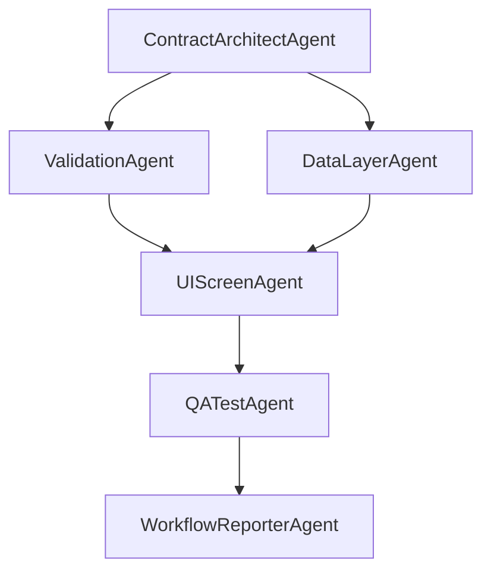
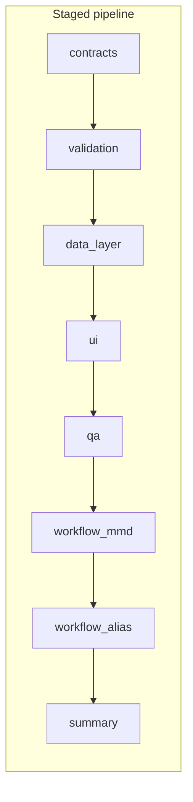

# Multi-agent pipeline — graphical overview

There are two complementary views of the same system.

## 1. Logical agent graph (dataflow)

This matches the **Mermaid** written by `WorkflowReporterAgent` into `docs/workflow-<MODULE>.mmd` after a successful `crew.py` run. Contracts feed both validation and data; both feed the UI; then QA and reporting.



Open the latest generated file:

- `docs/workflow-patients.mmd` (when `MODULE=patients`)

## 2. Staged execution order (what actually runs)

[`crew.py`](../crew.py) runs **eight separate CrewAI `kickoff()` calls** in sequence; the filesystem is the handoff between stages. Optional pauses between stages help **Groq TPM** (see README).



## 3. LangGraph export (library graph)

The script `langgraph_visualize.py` emits a **LangGraph**-shaped graph (slightly different naming, same idea) as Mermaid **and** PNG when rendering works:

```bash
export MODULE=patients
python3 langgraph_visualize.py
```

Artifacts:

| File | Purpose |
|------|---------|
| `docs/langgraph-workflow-<MODULE>.mmd` | Mermaid for the LangGraph model |
| `docs/langgraph-workflow-<MODULE>.png` | PNG (if generation succeeds) |
| `docs/langgraph-workflow.mmd` | Alias to latest module run |
| `docs/langgraph-summary.md` | Short text summary |

### Viewing `.mmd` files

- **VS Code / Cursor**: install a Mermaid preview extension, or paste into [mermaid.live](https://mermaid.live).
- **PNG**: open `docs/langgraph-workflow-<MODULE>.png` directly in any image viewer.
